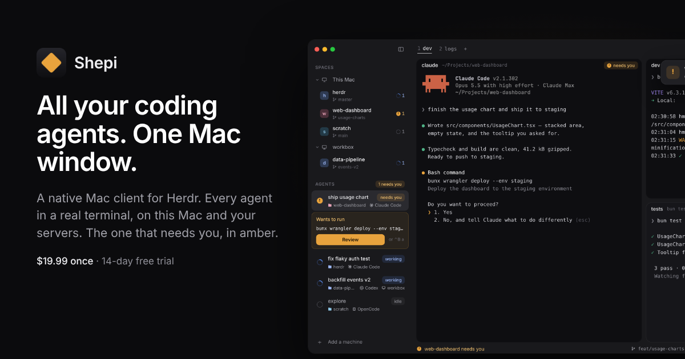

# Shepi for Herdr

Shepi is a native Mac client for Herdr.

**All your coding agents. One Mac window. Two keys to the one that needs you.**

[Herdr](https://herdr.dev) is the terminal runtime that keeps your agents alive. Claude Code, Codex, OpenCode, Gemini CLI, Cursor, Copilot CLI: in Shepi every one of them runs in a real terminal, at once, on this Mac or your servers, with the one that needs you in amber.

- **The server never stopped. The client just showed up.** Open Shepi and every space, tab and agent you already have in Herdr is there, in real terminals, exactly where you left them.
- **When one of them needs you, you hear about it.** The agent turns amber in the sidebar, the pane header and the status line, a banner finds you, and you hear Herdr's own sound. The prefix and `a` takes you straight there.
- **Your agents can ask you properly.** An agent can ask you a real question with buttons, open a page on your Mac, report its progress under its name, and open a pane beside itself. On your servers too.
- **See what your agent changed.** Every file changed since the last commit, side by side or in one column, on this Mac or a server.
- **Agents on your other machines join the same sidebar.** Add any machine you reach over SSH, right from Shepi.
- **Macros, Find and the inbox.** One key types a whole sequence into an agent; one search finds every space, agent, pane and line of output; every agent that finished or needed you while you were away waits in the inbox.
- **Private by design.** No analytics, no crash reports, no Shepi account.

## Get it

- [Download](https://shepi.app/download)
- [Guide](https://shepi.app/guide)
- [Compare](https://shepi.app/compare)
- [FAQ](https://shepi.app/#faq)
- [Release notes](CHANGELOG.md)

**Needs** macOS 14 or later (Apple silicon and Intel, notarized) and Herdr 0.9.3 or later.

**Price:** $19.99 once, every future update included. Try everything for 14 days first, with no account and no card.

## Feedback

Report a problem or ask for a feature in [Issues](../../issues/new/choose), or talk it over in [Discussions](../../discussions). Everything here is public. For a private report, use Help › Send Feedback in Shepi: only the developer reads it.

This repository holds Shepi's release notes and public feedback; Shepi's source code isn't here.

---

Shepi for Herdr is made by WIO and isn't affiliated with Herdr.
